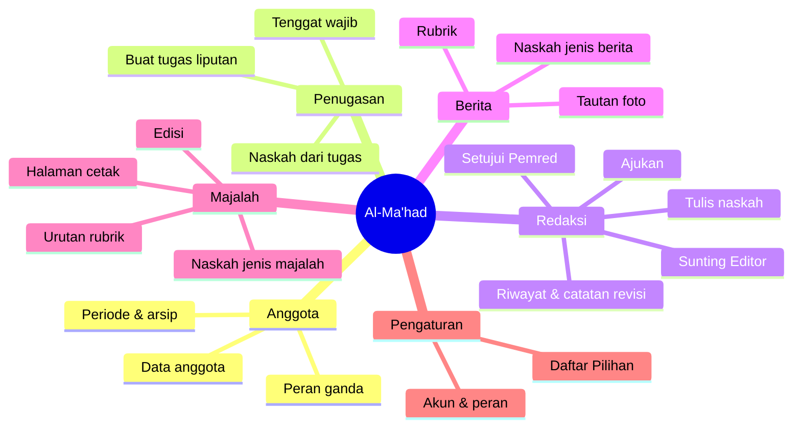
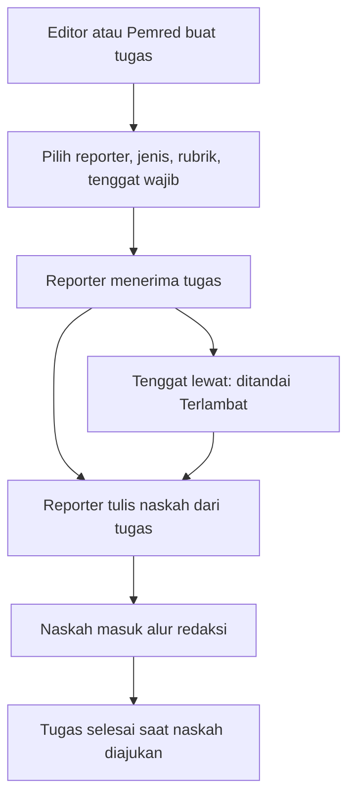
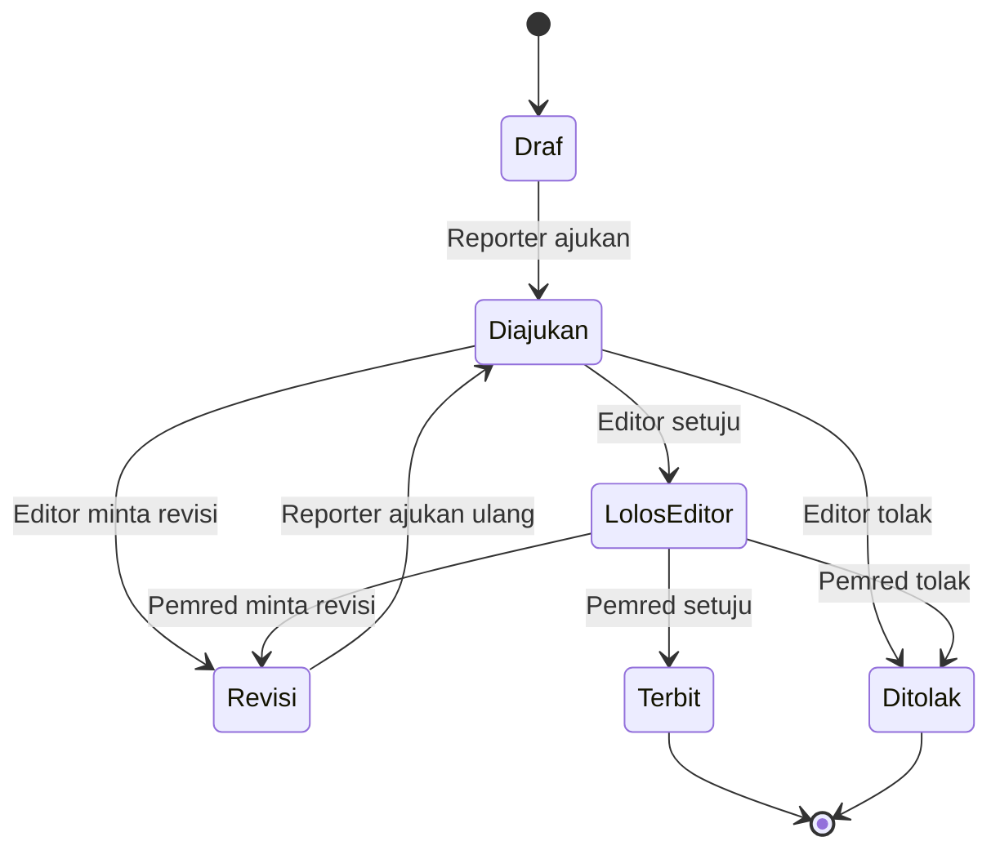
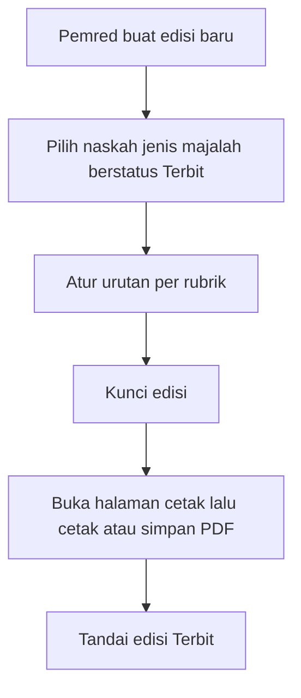

# Al-Ma'had — Desain Sistem (Draf 8)

> Status: **TAHAP KODE — Tahap 1** (login, anggota, periode, daftar pilihan). Keputusan baru tetap dicatat di sini.
> Proyek ini **berdiri sendiri**: tidak terkait ProjectJao/HISADA, inventaris Amar, maupun Veinmara.

## 1. Gambaran

Al-Ma'had adalah **organisasi jurnalistik santri** di lingkungan pondok. Sistem ini adalah **alat kerja internal redaksi**:
mengelola anggota, memberi tugas liputan, menulis naskah, menyunting berjenjang, lalu menerbitkan naskah sebagai **berita**
atau menyusunnya ke dalam **edisi majalah**. Tidak ada halaman untuk pembaca umum — "terbit" berarti naskah siap dipakai
(cetak, mading, media sosial).

## 2. Keputusan

| No | Keputusan | Positif | Negatif |
|----|-----------|---------|---------|
| A-01 | Hosting Cloudflare (Workers + D1), **akun Cloudflare terpisah**; Worker `almahad` → https://almahad.jaohongk.workers.dev; ID database D1: `0a95fda8-2dd8-4fd3-bff4-31bbea81ee5a` | Benar-benar lepas dari proyek lain; gratis | Perlu login wrangler terpisah di PC ini |
| A-02 | Kode disimpan di repo GitHub **publik** [Peelutk/almahad](https://github.com/Peelutk/almahad) (salinan kerja lokal `C:\HISADA\almahad`) | Ada cadangan & riwayat; bisa dihubungkan ke Workers Builds untuk deploy otomatis | Siapa pun bisa membaca desain & kode → rahasia (client secret, token) tidak boleh masuk repo |
| A-03 | **Desain dulu**, kode belakangan | Struktur matang sebelum dibangun | Hasil yang bisa dicoba muncul lebih lambat |
| A-04 | Pengguna: Reporter, Editor, Pemred, Admin | Tanpa pembaca umum → lebih sederhana & aman | Hasil kerja tidak terlihat publik dari sistem |
| A-05 | Alur redaksi **Reporter → Editor → Pemred → Terbit** | Kualitas terjaga dua lapis | Naskah lebih lama sampai terbit |
| A-06 | Majalah = **edisi kumpulan naskah**; tata letak di luar sistem (Canva/InDesign) | Ringan; desainer bebas berkreasi | Perlu ekspor naskah ke alat tata letak |
| A-07 | "Terbit" = **internal saja** | Tidak perlu moderasi publik | Arsip tidak bisa dibaca orang luar |
| A-08 | Login **Google**, hanya email **`@daarululuumlido.com`** | Tanpa kata sandi; orang luar pondok tidak bisa masuk | Butuh OAuth client Google; anggota tanpa email sekolah tidak bisa masuk |
| A-09 | Naskah **berita** dan naskah **majalah** **dipisah** (jenis dipilih saat naskah dibuat) | Alur dan arsip jelas; tidak ada naskah ganda | Tulisan yang cocok untuk keduanya harus ditulis/disalin dua kali |
| A-10 | Foto **tidak diunggah**; naskah cukup menyimpan **tautan file foto** (mis. Google Drive) | Tanpa R2; D1 tetap kecil; gratis | Foto bisa hilang/terkunci jika izin tautan berubah; tidak ada pratinjau terjamin |
| A-11 | **Penugasan liputan** lewat sistem | Tugas & tenggat tercatat; mudah dipantau | Menambah satu alur dan satu tabel |
| A-12 | Satu anggota boleh punya **lebih dari satu peran** | Cocok untuk organisasi kecil (mis. Editor + Admin) | Hak akses digabung; perlu aturan agar orang tidak menyetujui naskahnya sendiri |
| A-13 | Edisi majalah **hanya disusun Pemred** | Satu penanggung jawab isi edisi | Beban Pemred bertambah |
| A-14 | Saat periode berganti, anggota lama **diarsipkan** (tidak dihapus) | Nama penulis naskah lama tetap tercatat | Data bertambah tiap periode |
| A-15 | Anggota **boleh menyunting/menyetujui naskahnya sendiri** bila punya perannya (tanpa larangan khusus) | Sederhana; Pemred yang menulis tetap bisa menerbitkan | Pemeriksaan dua lapis bisa terlewati; mengandalkan kejujuran anggota (riwayat tetap mencatat siapa yang menyetujui) |
| A-16 | Tugas liputan **tidak bisa ditolak** reporter dan **wajib punya tenggat tanggal** | Tugas pasti dikerjakan; pemantauan jelas | Reporter yang berhalangan harus minta pemberi tugas mengubah/membatalkan tugas |
| A-17 | Reporter **boleh menulis naskah tanpa tugas** (inisiatif sendiri) | Kreativitas anggota tidak terhambat | Beban sunting Editor bisa bertambah |
| A-18 | **Tidak ada divisi** | Data anggota lebih sederhana | Pengelompokan anggota hanya lewat peran |
| A-19 | Ekspor majalah = **halaman cetak** dari browser, rapi seperti Google Docs (cetak / simpan PDF) | Tanpa pustaka tambahan; langsung bisa dicetak | Tata letak cetak sederhana; teks perlu disalin manual ke Canva/InDesign bila didesain ulang |
| A-20 | Modul khusus **Daftar Pilihan**: semua isian yang bersifat *dipilih* (rubrik berita, rubrik majalah, dll.) disimpan di **satu tabel** dan diatur lewat satu halaman; tidak ada daftar rubrik bawaan | Isi pilihan bisa diubah tanpa mengubah kode; satu tempat untuk semua daftar | Kesalahan ubah/hapus pilihan berdampak ke banyak data → pilihan yang sudah dipakai hanya bisa **dinonaktifkan**, tidak dihapus |
| A-21 | Daftar Pilihan untuk sementara hanya berisi **rubrik berita** dan **rubrik majalah**; kelompok lain ditambah nanti bila perlu | Mulai sederhana | Penambahan kelompok baru nanti butuh sedikit perubahan |
| A-22 | Daftar Pilihan dikelola **Admin dan Pemred** | Pemred bisa langsung menambah rubrik sesuai kebutuhan redaksi | Dua pihak bisa mengubah; perubahan perlu dicatat |
| A-23 | Tugas lewat tenggat **cukup ditandai "Terlambat"** dan tetap bisa dikerjakan | Tidak ada naskah yang hilang karena telat | Tenggat bisa kurang dihargai; Editor/Pemred memantau sendiri |
| A-24 | Tampilan **sederhana**, warna dari logo (hijau tua `#00A859`, hijau muda `#88C44A`), tema **terang/gelap mengikuti perangkat** | Identitas konsisten; nyaman di HP & malam hari | Dua set warna harus dirawat; hijau logo terlalu terang untuk teks di latar putih → tombol memakai hijau lebih gelap `#007A41` |
| A-25 | Kode dibangun **bertahap**; Tahap 1 = login Google, Anggota & peran, Periode, Daftar Pilihan | Fondasi teruji sebelum alur redaksi | Fitur redaksi belum bisa dipakai di Tahap 1 |
| A-26 | Deploy lewat **Workers Builds** dari GitHub (push ke `main` = deploy) | Tanpa login wrangler di PC; deploy otomatis | Setiap push langsung tayang → push hanya setelah uji lulus |
| A-27 | **Admin awal** = `216326@daarululuumlido.com`, otomatis Admin + Pemred saat pertama masuk (hanya selama belum ada Admin) | Tidak perlu halaman penyiapan | Email admin awal tertulis di konfigurasi publik |
| A-28 | Ganti periode: Admin mencentang anggota yang **lanjut**; sisanya diarsipkan otomatis, Admin yang mengganti selalu ikut lanjut | Sesuai A-14, tidak ada yang terkunci tanpa sengaja | Anggota yang lupa dicentang harus diaktifkan kembali manual |
| A-29 | Harus selalu ada **minimal satu Admin aktif** (sistem menolak perubahan yang melanggar) | Sistem tidak pernah kehilangan pengelola | — |
| A-30 | Logo asli **tidak** masuk repo; aplikasi memakai tanda lingkaran dua warna hijau | Berkas logo tetap privat | Tampilan belum memakai logo asli |

## 3. Mindmap

## 4. Peran & hak akses

| Kemampuan | Reporter | Editor | Pemred | Admin |
|-----------|:-------:|:------:|:------:|:-----:|
| Tulis & ajukan naskah sendiri | ✔ | ✔ | ✔ | – |
| Beri tugas liputan | – | ✔ | ✔ | – |
| Sunting naskah orang lain / minta revisi | – | ✔ | ✔ | – |
| Setujui akhir (terbitkan) | – | – | ✔ | – |
| Susun edisi majalah | – | – | ✔ | – |
| Kelola anggota, periode | – | – | – | ✔ |
| Kelola Daftar Pilihan | – | – | ✔ | ✔ |

Peran ganda = gabungan hak dari semua perannya. Menyetujui naskah sendiri **diperbolehkan** (A-15); riwayat tetap mencatat siapa yang menyetujui.

## 5. Alur penugasan liputan

## 6. Alur naskah

Setiap perpindahan status dicatat (siapa, kapan, catatan). Naskah **berita** selesai di status Terbit;
naskah **majalah** yang Terbit siap dimasukkan ke edisi.

## 7. Alur majalah

## 8. Rancangan database (D1) — draf

| Tabel | Kolom utama |
|-------|-------------|
| `anggota` | id, email (unik, `@daarululuumlido.com`), nama, kelas, periode_id, status (`aktif`/`arsip`) |
| `anggota_peran` | anggota_id, peran (`reporter`/`editor`/`pemred`/`admin`) — satu baris per peran |
| `periode` | id, nama (mis. 2026/2027), mulai, selesai, aktif |
| `pilihan` | id, kelompok (mis. `rubrik_berita`, `rubrik_majalah`), nilai, urutan, aktif — modul Daftar Pilihan (A-20) |
| `tugas` | id, judul, keterangan, jenis, rubrik_id → `pilihan`, pemberi_id, reporter_id, tenggat (wajib), status (`baru`/`dikerjakan`/`selesai`/`batal`); "terlambat" dihitung dari tenggat, tidak disimpan |
| `naskah` | id, jenis (`berita`/`majalah`), judul, rubrik_id → `pilihan`, penulis_id, tugas_id (boleh kosong), isi, status, dibuat_at, diubah_at |
| `naskah_foto` | id, naskah_id, tautan, keterangan |
| `naskah_riwayat` | id, naskah_id, dari_status, ke_status, oleh_id, catatan, waktu |
| `edisi` | id, nomor, tema, bulan_terbit, status (`disusun`/`dikunci`/`terbit`) |
| `edisi_naskah` | edisi_id, naskah_id, urutan |
| `sesi` | token, anggota_id, kedaluwarsa |

## 9. Rancangan tampilan

Prototipe statis: `prototipe/index.html` (data contoh, tombol belum berfungsi; logo dari `aset/` yang tidak masuk repo). Aplikasi asli Tahap 1 ada di `public/`.

| Halaman | Pengguna | Isi |
|---------|----------|-----|
| Masuk | semua | Tombol Masuk dengan Google; hanya `@daarululuumlido.com` |
| Dasbor | semua | Ringkasan sesuai peran: tugas saya, perlu disunting, menunggu Pemred, edisi disusun |
| Tugas Liputan | Reporter, Editor, Pemred | Daftar tugas, tanda **Terlambat**; Editor/Pemred: Beri tugas (tenggat wajib) |
| Naskah | Reporter, Editor, Pemred | Tab Semua/Berita/Majalah; tulis naskah; halaman naskah dengan tautan foto, tombol sesuai status & peran, riwayat |
| Antrean Redaksi | Editor, Pemred | Perlu disunting; menunggu persetujuan akhir |
| Edisi Majalah | Pemred | Daftar edisi; susun & urutkan naskah; kunci; halaman cetak |
| Halaman cetak | Pemred | Tampilan seperti dokumen (kertas putih, per rubrik) → Cetak / Simpan PDF |
| Anggota | Admin | Daftar per periode, peran ganda, status arsip |
| Daftar Pilihan | Admin, Pemred | Tab rubrik berita/majalah; tambah, urutkan, nonaktifkan |

## 10. Pertanyaan terbuka

Tidak ada. Desain draf ini **lengkap**; langkah berikutnya (perubahan prototipe atau mulai kode) menunggu persetujuan Hong Khai.
